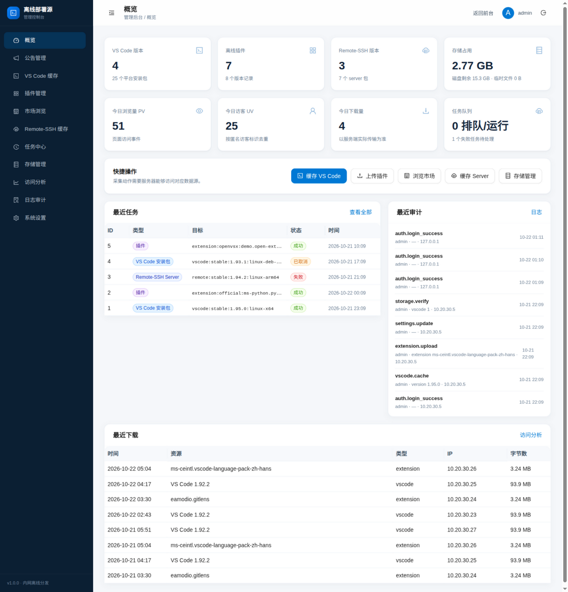
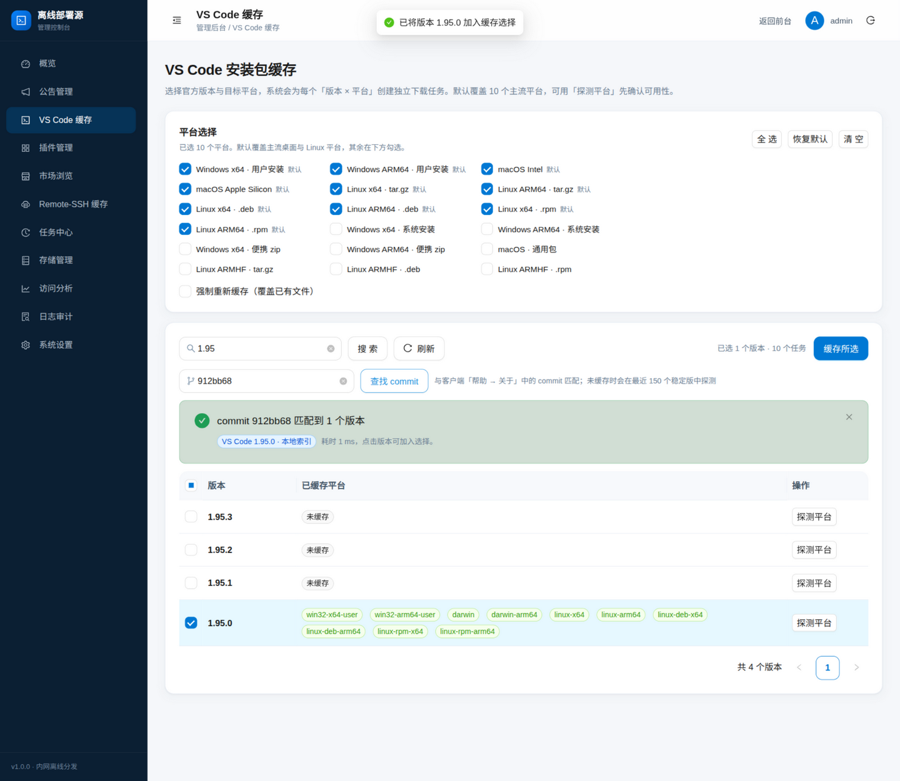
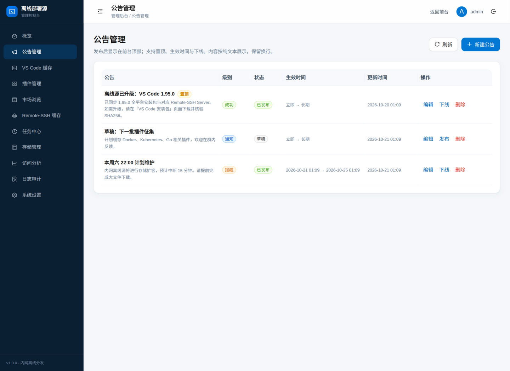
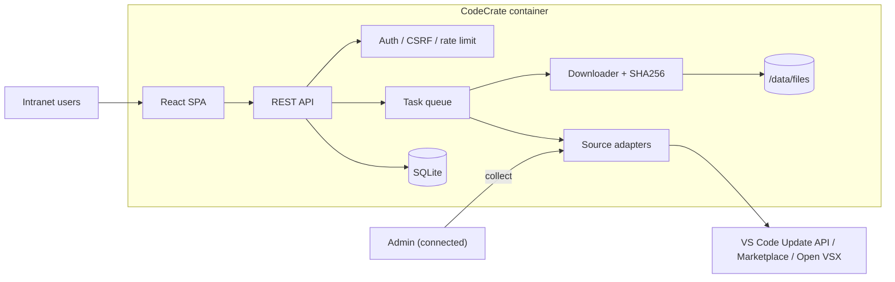

<div align="center">


# CodeCrate

**A self-hosted, air-gapped registry for VS Code installers, extensions and Remote-SSH servers**

Cache once on a connected admin network. Let isolated users browse, verify and download — no internet, no user accounts required.

[](https://github.com/ygxiuming/codecrate/releases)
[](https://github.com/ygxiuming/codecrate/actions/workflows/ci.yml)
[](https://github.com/ygxiuming/codecrate/actions/workflows/docker.yml)
[](LICENSE)
[](https://nodejs.org/)
[](https://github.com/ygxiuming/codecrate/pkgs/container/codecrate)
[](https://github.com/ygxiuming/codecrate)

[简体中文](README.md) ｜ [Changelog](CHANGELOG.md) ｜ [Architecture](docs/ARCHITECTURE.md) ｜ [Issues](https://github.com/ygxiuming/codecrate/issues) ｜ [Releases](https://github.com/ygxiuming/codecrate/releases)

**If CodeCrate saves you from one more offline-deployment headache, please give it a ⭐ Star.**


</div>

## Table of contents

- [Why CodeCrate](#why-codecrate)
- [Features](#features)
- [Screenshots](#screenshots)
- [Quick start](#quick-start)
- [Configuration](#configuration)
- [Architecture](#architecture)
- [Automated image builds](#automated-image-builds)
- [Security](#security)
- [Development](#development)
- [Offline distribution](#offline-distribution)
- [Compliance](#compliance)
- [Support the project](#support-the-project)
- [Contributing](#contributing)
- [License](#license)

## Why CodeCrate

Air-gapped development environments usually hit the same three walls:

1. **VS Code installers** must be prepared host by host, across many platforms and architectures.
2. **The extension marketplace is unreachable**, so `.vsix` files are collected by hand and metadata is easy to lose.
3. **Remote-SSH cannot download its server**, and clients stall when the local and remote commits differ.

CodeCrate caches all three resource types inside your network behind a searchable public site and an authenticated admin console, with job progress, integrity verification, resumable downloads and access analytics. It ships as a single Docker container.

> **CodeCrate = Code + Crate**: pack your internet-only developer resources into one crate you can carry inside.

## Features

- **VS Code installers** — list all official stable versions, select multiple versions and platforms (Windows user installers, macOS Intel/Apple Silicon, Linux tar.gz/deb/rpm, plus system installers and portable zips), and cache them in the background.
- **Offline extensions** — upload `.vsix` files with automatic metadata parsing (ID, publisher, version, engine range, dependencies, extension packs, categories, icon), or search the official Marketplace / Open VSX and cache with one click; the cache dialog lists every historical version.
- **Remote-SSH server** — resolve the commit for a VS Code version and cache `vscode-server` for Linux x64/ARM64/ARMHF, macOS ARM64 and Windows x64. Configure a mirror for automatic downloads, or upload an offline server archive manually; version and commit are read from the bundled `product.json`. Native Remote-SSH integration is available via an update-server-compatible `/api/vscode-update/commit:<commit>/server-<platform>/stable` endpoint (`remote.SSH.useOSS` + `ossDownloadUrl`), or `manual-bootstrap` for client-side download plus automatic SCP.
- **Task queue** — persistent SQLite-backed jobs with progress, retries with backoff, cancellation, resumable `.part` downloads and per-task event logs.
- **Integrity** — streaming SHA256, hash verification, range downloads and full storage accounting; one-click cache-folder scan imports files copied in manually and removes records whose files were deleted.
- **Anonymous access + optional access code** — intranet users can browse/download without accounts; an admin can require a shared access code.
- **Open-source entry points** — GitHub, issue and Star links in the public header/footer, plus a project description and Star callout on the home page.
- **Analytics** — page views, unique visitors, clicks, searches and real downloads with full IP logging (90-day retention by default), CSV export and configurable retention.
- **Announcements** — publish, pin, schedule and expire notices shown in a public modal with remembered dismissal.
- **VS Code gallery gateway** — an `extensionsGallery`-compatible read-only API so a configured VS Code client can search and install cached extensions directly.
- **Commit lookup** — paste a commit from VS Code "About" and the admin UI resolves and selects the matching version.
- **Security** — scrypt passwords, DB-backed sessions, CSRF origin checks, login rate limiting, audit logs, SSRF-safe egress (DNS + connect-time IP validation), zip-bomb-safe vsix parsing and path-contained downloads.

## Screenshots

| Extensions | Admin |
| --- | --- |
|  |  |

| VS Code installers | Analytics |
| --- | --- |
|  |  |

| VS Code cache (commit lookup) | Announcements |
| --- | --- |
|  |  |

## Quick start

Requirements: Docker 24+ (Compose v2 for the Compose path).

### Option 1: use the published image (recommended)

```bash
docker run -d --name codecrate \
  -p 3000:3000 \
  -v "$PWD/data:/data" \
  -e ADMIN_PASSWORD='change-me-strong' \
  ghcr.io/ygxiuming/codecrate:latest
```

Open <http://<host>:3000>; the admin console is at `/admin`. If `ADMIN_PASSWORD` is omitted, a random password is printed in the logs and written to `data/initial-admin-password`.

### Option 2: clone and use Compose

```bash
git clone https://github.com/ygxiuming/codecrate.git
cd codecrate
cp .env.example .env
# Edit .env and set ADMIN_PASSWORD
docker compose up -d --build
docker compose logs -f registry
```

### Development

```bash
npm install
ADMIN_PASSWORD='dev-password-123' npm run dev
# API: http://127.0.0.1:3000
# UI:  http://127.0.0.1:5173
```

The host `./data` directory is bind-mounted to `/data` and keeps the SQLite database and all cached artifacts across upgrades. Set `DATA_DIR_HOST` to use another path. The entrypoint fixes directory ownership as root, then drops to the unprivileged `node` user (UID 1000).

### Upgrade

```bash
docker compose pull
docker compose up -d
```

## Configuration

Environment variables (see [`.env.example`](.env.example)):

| Variable | Default | Purpose |
| --- | --- | --- |
| `APP_PORT` | `3000` | Published host port |
| `DATA_DIR_HOST` | `./data` | Host data directory mounted at `/data` |
| `IMAGE_NAME` | `codecrate:1.0.0` | Image used by Compose (GHCR address allowed) |
| `PORT` | `3000` | HTTP port |
| `DATA_DIR` | `/data` | Data root |
| `STORAGE_DIR` | `$DATA_DIR/files` | Artifact storage |
| `DB_PATH` | `$DATA_DIR/registry.db` | SQLite database |
| `WEB_DIST` | `/app/web/dist` | Built frontend assets |
| `SITE_NAME` | `CodeCrate 离线部署源` | Public site name |
| `ADMIN_USERNAME` | `admin` | Bootstrap admin |
| `ADMIN_PASSWORD` | random | Bootstrap password (≥10 chars) |
| `PUBLIC_ORIGIN` | empty | Canonical public URL for origin checks and docs |
| `ALLOWED_ORIGINS` | empty | Extra allowed write origins (comma-separated) |
| `TRUST_PROXY` | `false` | Number of trusted proxy hops |
| `COOKIE_SECURE` | `auto` | `auto` / `always` / `never` |
| `NETWORK_ALLOWED_PRIVATE_HOSTS` | empty | Explicitly allow intranet mirrors |
| `CACHE_CONCURRENCY` | `3` | Concurrent cache jobs |
| `DOWNLOAD_CONCURRENCY_PER_IP` | `4` | Per-IP concurrent downloads |
| `UPLOAD_MAX_BYTES` | `209715200` | `.vsix` upload limit (200 MB) |
| `ACCESS_LOG_ENABLED` | `true` | Enable access logging |
| `ACCESS_LOG_RETENTION_DAYS` | `90` | Access log retention (0 = forever) |
| `CLAMSCAN_PATH` | empty | Optional ClamAV binary |
| `LOG_LEVEL` | `info` | pino log level |
| `TZ` | `Asia/Shanghai` | Container timezone |

Data sources, access code, upload limit and other options can also be changed in the admin UI.

### Reverse proxy

Set `TRUST_PROXY=1` and `COOKIE_SECURE=auto` behind a single Nginx/Caddy hop. If the proxy rewrites `Host`, set `PUBLIC_ORIGIN` or extend `ALLOWED_ORIGINS`. Only trust one proxy hop to prevent forged `X-Forwarded-For` headers.

### Proxy fake-IP mode

Clash/Surge fake-IP maps public hostnames into `198.18.0.0/15`, which the SSRF guard rejects by default. Explicitly allow the official hosts when this is intentional:

```bash
NETWORK_ALLOWED_PRIVATE_HOSTS=update.code.visualstudio.com,*.microsoft.com,*.visualstudio.com,*.vsassets.io,*.open-vsx.org,*.eclipsecontent.org
```

## Architecture



See [`docs/ARCHITECTURE.md`](docs/ARCHITECTURE.md) for details.

## Automated image builds

[`.github/workflows/docker.yml`](.github/workflows/docker.yml) builds and pushes to GHCR:

| Trigger | Tags | Notes |
| --- | --- | --- |
| Push to `main` | `main`, `sha-<short>`, `latest` | Latest default-branch image |
| Push tag `v1.2.3` | `1.2.3`, `1.2`, `1`, `latest` | Version release |
| Pull request | none | amd64 build validation only |
| `workflow_dispatch` | same as above | Manual trigger |

Images are built for `linux/amd64` and `linux/arm64` with SLSA provenance and SBOM. See [Releases](https://github.com/ygxiuming/codecrate/releases).

## Security

- Change the bootstrap password immediately and delete `data/initial-admin-password`.
- Keep `/admin` on a trusted network; put it behind HTTPS/VPN.
- All outbound requests are validated against private/reserved IP ranges. Intranet mirrors must be explicitly allowlisted.
- The gallery gateway is read-only and intentionally does not require the browser access code; restrict it at the network layer.
- Access logs contain full IP addresses; document retention and privacy expectations for your organization.

See [SECURITY.md](SECURITY.md) for vulnerability reporting.

## Development

```bash
npm run typecheck
npm run lint
npm test
npm run build
```

Tests use a local mock source and cover downloads, resumable ranges, vsix parsing, marketplace caching (including gzip), commit lookup, gallery responses, announcements, access logging and storage verification.

## Offline distribution

Build or pull the image on a connected machine, then export it:

```bash
docker save codecrate:1.0.0 | gzip > registry-image.tar.gz
```

Carry the archive, `docker-compose.yml` and `.env.example` into the isolated network:

```bash
gunzip -c registry-image.tar.gz | docker load
cp .env.example .env
docker compose up -d
```

## Compliance

This project is not affiliated with Microsoft. The Visual Studio Marketplace gallery API is primarily intended for VS Code clients; using it from third-party clients may be subject to service terms. Switch to Open VSX or upload `.vsix` files manually where compliance matters. No Microsoft binaries or extensions are included in this repository.

## Support the project

CodeCrate is MIT-licensed and maintained in the open:

- ⭐ Star the [GitHub repository](https://github.com/ygxiuming/codecrate) so more teams can find it;
- Share it with colleagues stuck on offline VS Code installs, an unreachable marketplace or Remote-SSH server downloads;
- Report problems and ideas in [Issues](https://github.com/ygxiuming/codecrate/issues), or send a pull request;
- Keep the GitHub entry in the public header/footer after deploying so the next user can find upstream.

## Contributing

Issues and pull requests are welcome. Please read [CONTRIBUTING.md](CONTRIBUTING.md) and [CODE_OF_CONDUCT.md](CODE_OF_CONDUCT.md) first, and make sure `npm run typecheck && npm run lint && npm test && npm run build` passes.

## License

[MIT](LICENSE) © 2026 CodeCrate contributors

VS Code and Visual Studio Marketplace are trademarks of Microsoft Corporation. This is an independent third-party tool with no affiliation to Microsoft.
