<div align="center">


# CodeCrate · 码箱

**面向内网的资源分发平台：软件安装包 · VS Code 资源 · 公共文件区 · 取件码传递 · 评论留言**

管理员在联网环境采集一次，内网用户即可浏览、校验并下载。无需外网，无需账号体系。

[](https://github.com/ygxiuming/codecrate/releases)
[](https://github.com/ygxiuming/codecrate/actions/workflows/ci.yml)
[](https://github.com/ygxiuming/codecrate/actions/workflows/docker.yml)
[](LICENSE)
[](https://nodejs.org/)
[](https://github.com/ygxiuming/codecrate/pkgs/container/codecrate)
[](https://github.com/ygxiuming/codecrate)

[English](README.en.md) ｜ [更新日志](CHANGELOG.md) ｜ [文档](docs/ARCHITECTURE.md) ｜ [问题反馈](https://github.com/ygxiuming/codecrate/issues) ｜ [发布版本](https://github.com/ygxiuming/codecrate/releases)

**如果 CodeCrate 帮你解决了隔离内网的离线部署问题，欢迎点一个 ⭐ Star 支持项目。**

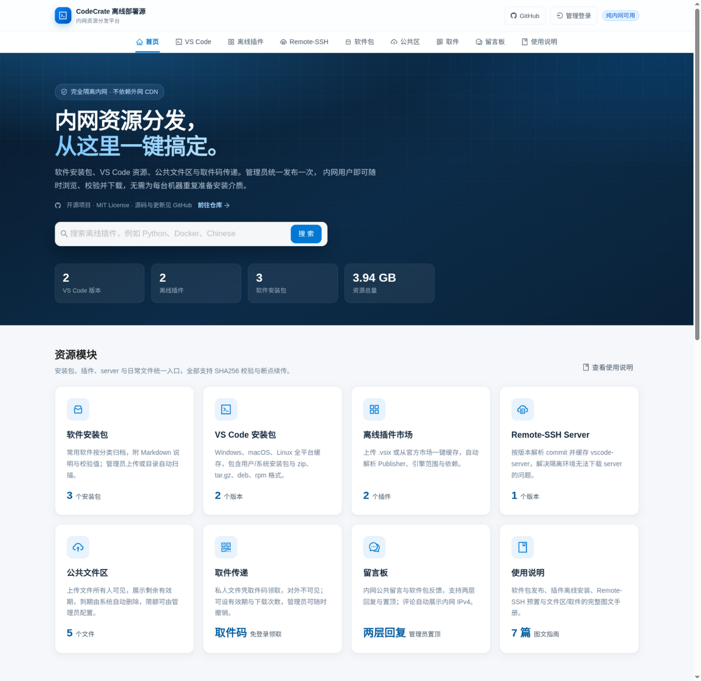

</div>

## 目录

- [为什么需要 CodeCrate](#为什么需要-codecrate)
- [功能](#功能)
- [界面预览](#界面预览)
- [快速开始](#快速开始)
- [自动构建与发布](#自动构建与发布)
- [配置](#配置)
- [使用流程](#使用流程)
- [离线镜像分发](#离线镜像分发)
- [安全设计](#安全设计)
- [API 概览](#api-概览)
- [本地开发与测试](#本地开发与测试)
- [目录结构](#目录结构)
- [备份、恢复与密码重置](#备份恢复与密码重置)
- [已知限制](#已知限制)
- [数据源与合规](#数据源与合规)
- [支持项目](#支持项目)
- [贡献](#贡献)
- [许可证](#许可证)

## 为什么需要 CodeCrate

隔离内网的环境通常面临三类问题：

1. **常用软件安装包**需要逐台准备，平台/架构多，版本难对齐；
2. **开发工具资源不可达**，VS Code 安装包、插件市场（`.vsix`）与 Remote-SSH server 依赖人工搜集，元数据与依赖关系容易遗漏；
3. **日常文件传递低效**，临时文件缺少统一的分享入口，也缺少可以所有人共享的公共空间。

CodeCrate 把这些资源统一收进内网：软件包按分类归档、VS Code 资源一键缓存、公共文件区所有人可见、私人文件凭取件码传递、留言板/评论加强交流。提供可搜索的前台、带鉴权的后台、任务进度、完整性校验、断点续传、到期自动清理与访问分析，并以单个 Docker 容器交付。

> **CodeCrate = Code + Crate（代码箱）**：把外网的开发资源装进一只可以搬进内网的箱子。

## 功能

### 普通用户前台

- 按平台筛选、搜索、分页浏览已缓存的 VS Code 版本；展示版本号、构建时间、平台、大小、SHA256。
- 已缓存插件的名称、Publisher、版本、引擎范围、分类、下载量与更新时间；支持搜索、分类、排序。
- 插件详情抽屉展示描述、依赖、Extension Pack 与多版本下载。
- Remote-SSH Server 按版本/平台展示 commit、大小与 SHA256；未缓存版本也可解析并显示 commit。
- 网页直链下载，支持 HTTP Range 断点续传。
- 内置使用说明：安装、校验、离线装插件、Remote-SSH 配置、VS Code 接入、FAQ。
- 公告弹窗：管理员发布的维护通知/版本提醒以弹窗展示，支持级别、置顶、定时生效与关闭记忆。
- 页头/页脚提供 GitHub 仓库、问题反馈与 Star 入口；首页包含开源项目说明与 Star 引导。
- 右上角「管理登录」入口直达后台。
- 可选「前台访问码」，开启后浏览与下载需输入共用访问码。
- **软件安装包**：多级分类导航（如「办公软件/文件管理」，最多 3 级）+ 标签筛选 + 最新/最热/名称排序；卡片带离线图标，详情附 Markdown 说明、SHA256 与反馈评论区，可下载校验文件。
- **软件投稿**：用户可上传安装包并填写信息提交审核，管理员同意后自动合并上架（可在系统设置中关闭）。
- **公共文件区**：上传文件所有人可见，展示剩余有效期，到期自动删除。
- **取件中心**：输入取件码即可下载私人分享的文件，无需登录。
- **留言板 / 评论区**：全站留言板与软件包反馈，支持两层回复、管理员置顶；评论自动展示内网 IPv4（管理员可开启脱敏）。

### 管理员后台

- 管理员账号密码登录；scrypt 哈希、DB 会话、登录限流、同源校验、审计日志。
- VS Code 版本列表、版本多选、平台多选（默认 10 个主流平台）、平台可用性探测、批量缓存。
- **按 commit 查找版本**：粘贴客户端「关于」中的 commit，自动匹配版本并加入缓存选择。
- `.vsix` 上传与自动解析：ID、名称、版本、Publisher、引擎范围、依赖、Extension Pack、分类、关键词、许可证、仓库、图标。
- 官方 Marketplace / Open VSX 双数据源检索（关键词、分类、下载量/更新时间排序），一键缓存；缓存弹窗列出全部历史版本，平台专用包可选择目标平台。
- Remote-SSH Server 按版本关联 commit，多平台缓存；支持配置镜像源自动下载，也支持手动上传离线 server 包（自动读取包内 `product.json` 识别版本与 commit）。
- Remote-SSH 原生接入：提供与官方 update 服务兼容的 `/api/vscode-update/commit:<commit>/server-<platform>/stable`，配合 `remote.SSH.useOSS` + `ossDownloadUrl` 让远端自动下载；或使用 `manual-bootstrap` 由客户端下载后自动 SCP 推送。
- **软件包管理**：手动上传（名称/版本/平台/多级分类/标签/图标/Markdown 说明），或将文件放到 `data/files/software/<分类>/<软件名>/<版本>/` 由系统自动扫描（同目录 `readme.md` / `<同名>.md` 自动作为说明，`icon.png` / `<同名>.png` 自动作为图标）；支持分类重命名（父级改名级联更新子分类）、批量删除 / 批量改分类 / 批量增删标签、统计卡片与排序。
- **投稿审核**：用户投稿进入待审队列；管理员可修改申请的备注 / 标签 / 分类后一键同意（自动合并上架，来源标记「投稿」）或拒绝（删除文件并留痕），支持限流与全局开关。
- 任务中心：排队/下载中/成功/失败/已取消统计、进度、自动退避重试、单条与批量重试/取消、清理已完成/失败任务、失败徽标提醒、失败原因与事件日志。
- 存储管理：分类占用、磁盘余量、逐项 SHA256 校验、删除、临时文件清理；支持一键扫描缓存目录，同步手动复制或删除的文件。
- 访问分析：PV/UV/下载/点击/搜索趋势，热门页面、资源、搜索词，事件明细与 CSV 导出。
- 公告管理：创建、编辑、发布/下线、删除、置顶、定时生效与过期。
- 审计日志与下载日志。
- **VS Code gallery 兼容网关**：配合 `product.json` 的 `extensionsGallery`，让客户端扩展面板直接搜索/安装已缓存插件（详见内置「VS Code 接入」文档）。
- **文件区管理**：公共区与私人取件的完整管理权（查看上传者 IP、延期、撤销、删除）；到期文件由系统自动清理并留审计。
- **评论管理**：置顶、删除（连带回复）、批量删除、按内容/IP/来源检索。
- 数据源、并发、上传上限、公共区限制（大小/黑名单/配额/保留期）、取件有效期、评论区开关与 IP 脱敏、访问码、日志保留期等在线配置，并可测试数据源连通性。

### 工程化

- 单容器设计：后端托管前端静态资源，提供多阶段 `Dockerfile` 与 `docker-compose.yml`；`data/` 目录映射到宿主机，镜像由 GitHub Actions 自动构建并推送 GHCR（amd64/arm64）。
- SQLite（WAL）元数据 + 本地卷文件存储，重启不丢数据。
- 数据源适配器化，便于替换镜像或扩展其他 IDE。
- SSRF 防护：仅 http/https、逐跳校验重定向、DNS + 连接期地址校验、默认拒绝私网。
- 下载链接基于资源 ID + 根目录约束，防路径遍历；上传校验 zip 魔数/条目/大小，防 zip 炸弹。
- MIT 许可，中英双语文档，GitHub Actions CI。

## 界面预览

| VS Code 安装包 | 插件市场 |
| --- | --- |
| 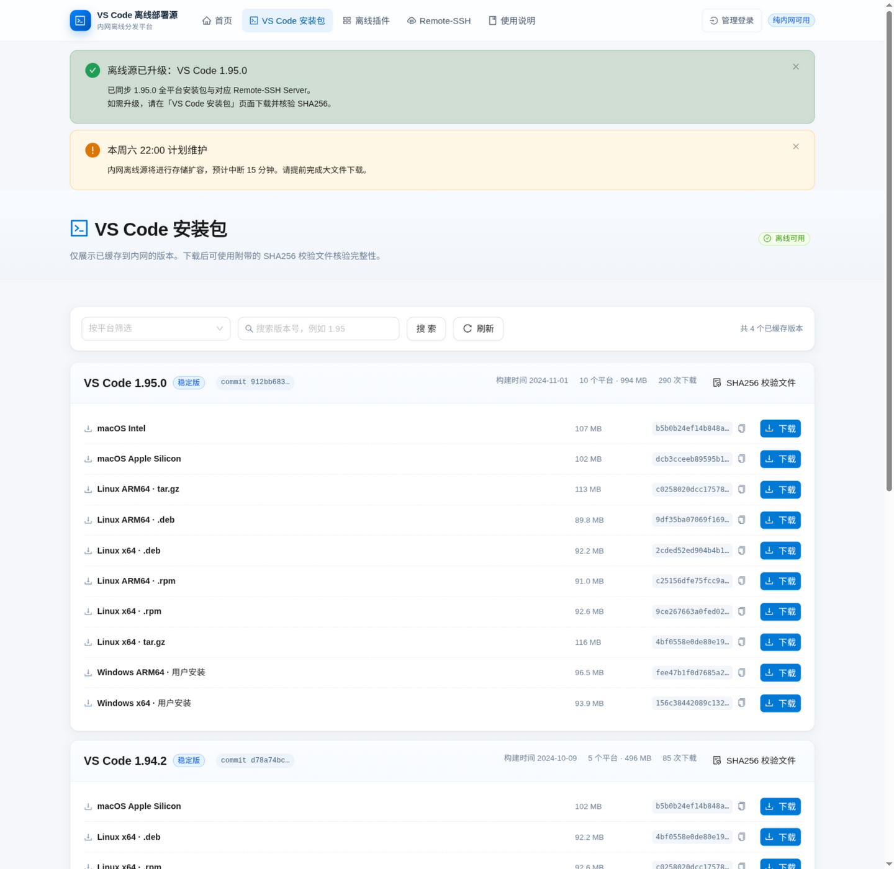 | 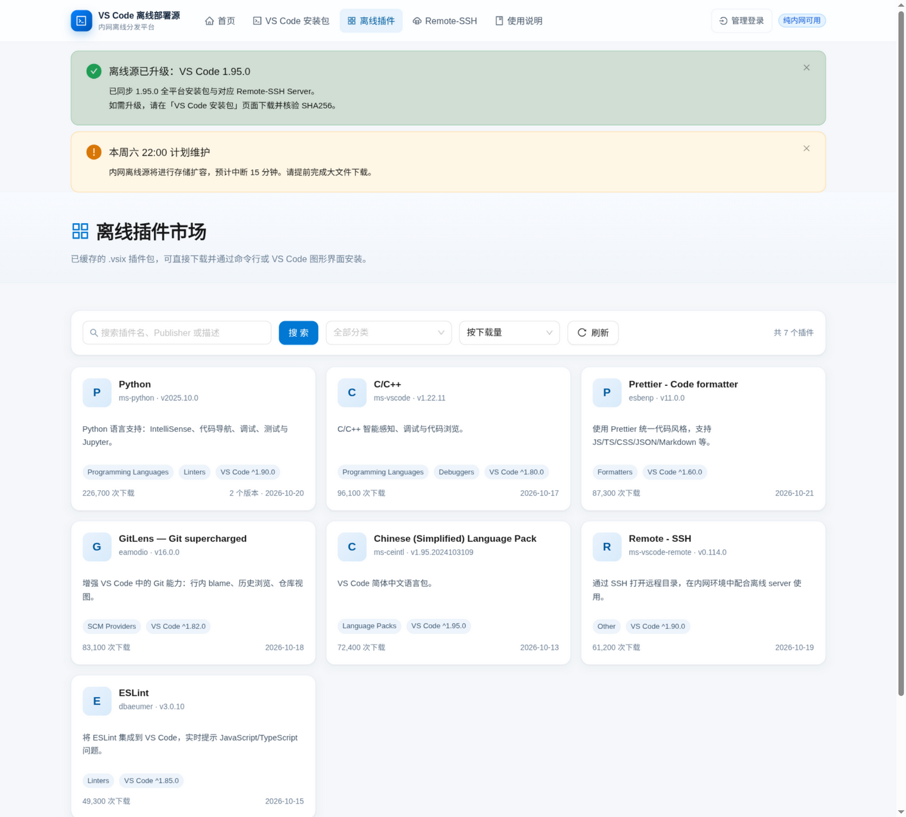 |

| 软件安装包 | 软件包详情（说明 + 反馈） |
| --- | --- |
| 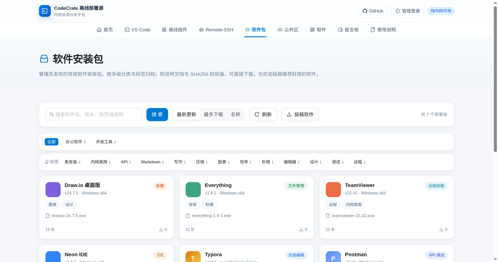 | 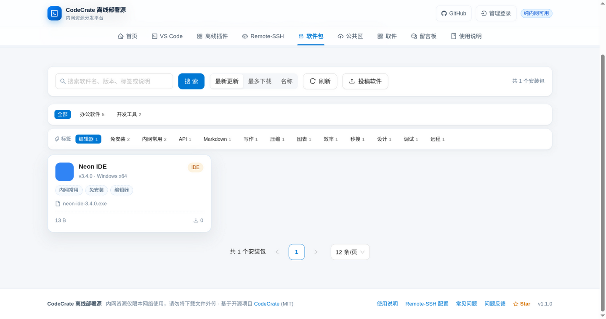 |

| 公共文件区 | 取件中心 |
| --- | --- |
| 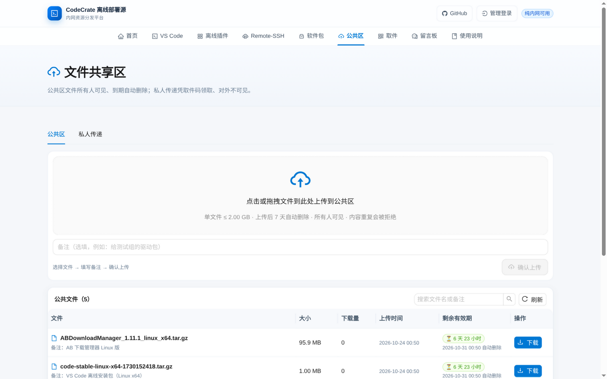 | 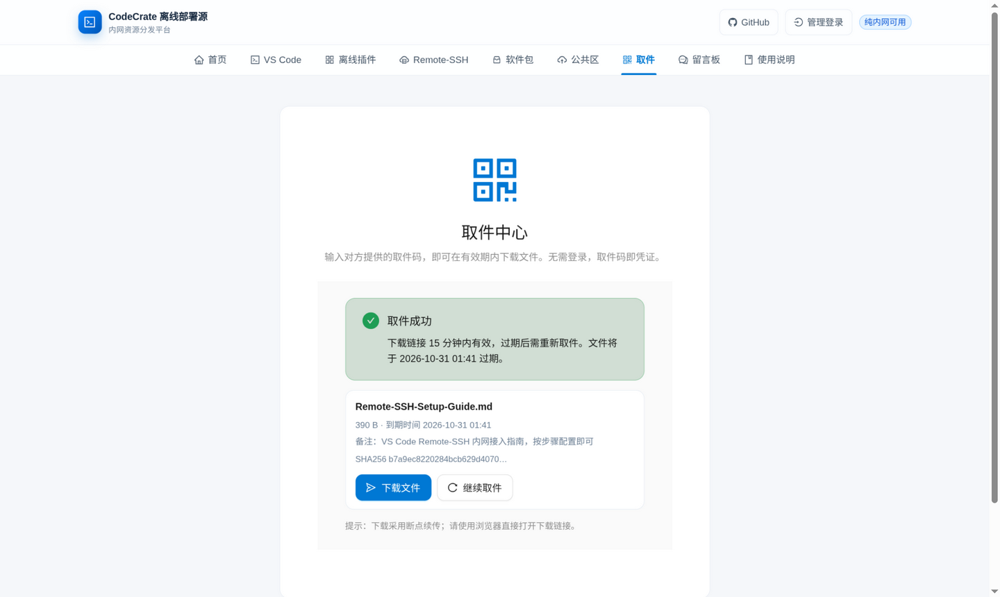 |

| 留言板 | 访问分析 |
| --- | --- |
| 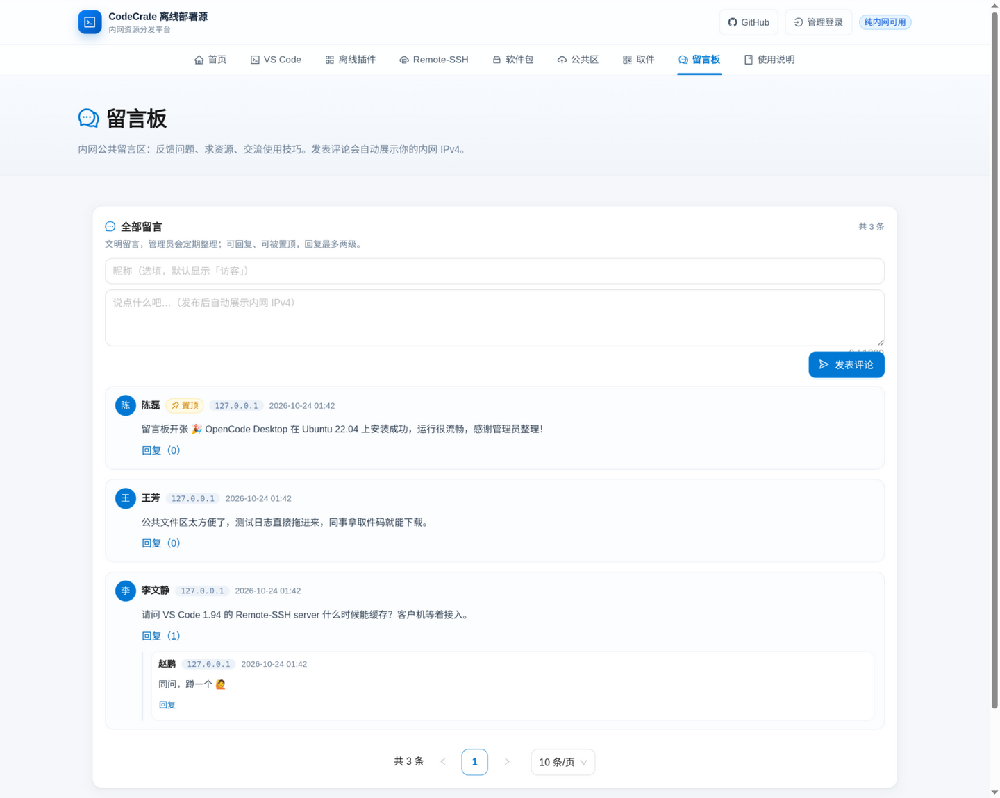 | 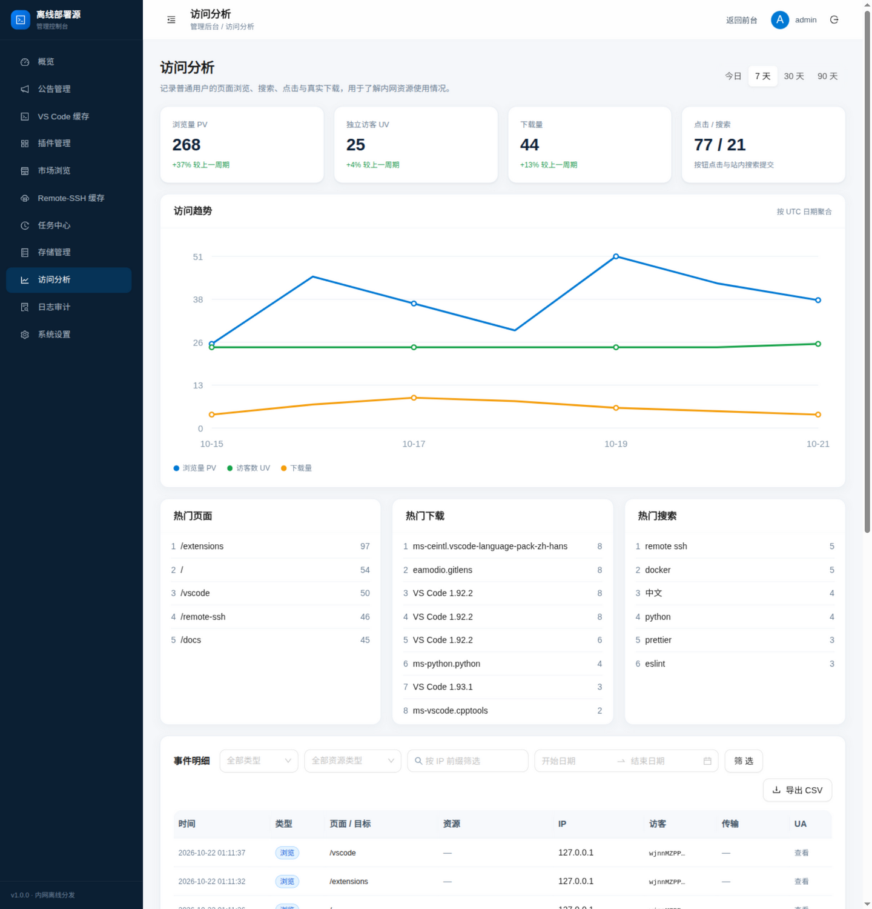 |

| 软件包管理（后台） | 文件区管理（后台） |
| --- | --- |
| 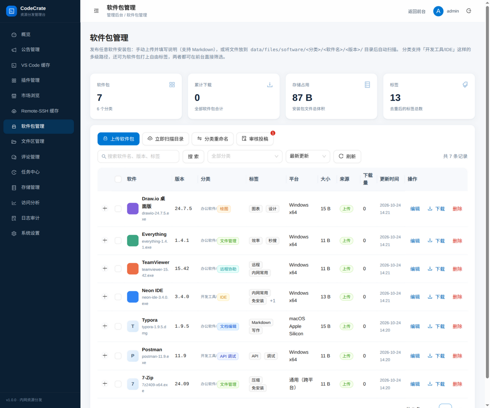 | 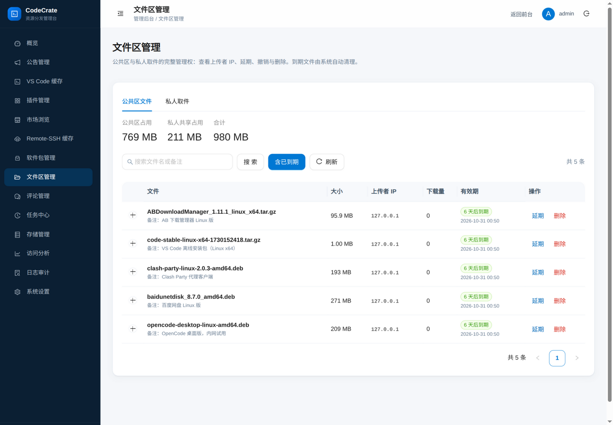 |

## 快速开始

要求：Docker 24+（使用 Compose 时需 v2）。

### 方式一：使用已发布镜像（推荐）

```bash
docker run -d --name codecrate \
  -p 3000:3000 \
  -v "$PWD/data:/data" \
  -e ADMIN_PASSWORD='change-me-strong' \
  ghcr.io/ygxiuming/codecrate:latest
```

打开 <http://服务器IP:3000>，后台在 `/admin`。首次启动若未设置 `ADMIN_PASSWORD`，随机密码会打印在日志中并写入 `data/initial-admin-password`。

> GHCR 包默认随仓库可见性；若 `docker pull` 提示未授权，请先在 [Packages](https://github.com/ygxiuming/codecrate/pkgs/container/codecrate) 页面确认可见性，或执行 `docker login ghcr.io`。

### 方式二：克隆后使用 Compose

```bash
git clone https://github.com/ygxiuming/codecrate.git
cd codecrate
cp .env.example .env
# 编辑 .env：至少修改 ADMIN_PASSWORD
docker compose up -d --build
docker compose logs -f registry
```

使用已发布镜像时，把 `.env` 中的 `IMAGE_NAME` 改为 `ghcr.io/ygxiuming/codecrate:latest`，然后 `docker compose pull && docker compose up -d`。

### 数据持久化

- 宿主机 `./data` 映射到容器 `/data`，SQLite 数据库、安装包、插件、图标与 Remote-SSH server 全部保存在这里；重建或升级容器不会丢失。
- 容器启动时先以 root 修正数据目录属主，随后立即降权到 `node`（UID 1000）运行应用，因此宿主机目录权限不对也不会导致 SQLite 或上传失败。
- 需要换位置时在 `.env` 中设置 `DATA_DIR_HOST=/srv/codecrate/data`（相对路径基于 `docker-compose.yml`）。
- `data/` 已在 `.gitignore` 中，不会提交到仓库；SELinux 主机（CentOS/RHEL）需额外执行 `chcon -Rt container_file_t ./data`。

### 首次登录

- 前台：<http://服务器IP:3000>
- 后台：<http://服务器IP:3000/admin>
- 默认用户名 `admin`。**登录后请立即修改密码**，并删除 `data/initial-admin-password`。

### 升级

```bash
# 使用 GHCR 镜像
docker compose pull
docker compose up -d

# 本地构建
docker compose build --pull
docker compose up -d
```

## 自动构建与发布

[`.github/workflows/docker.yml`](.github/workflows/docker.yml) 会在以下时机自动构建镜像并推送到 GitHub Container Registry（GHCR）：

| 触发 | 推送的标签 | 说明 |
| --- | --- | --- |
| push 到 `main` | `main`、`sha-<短哈希>`、`latest` | 默认分支的最新镜像 |
| push tag `v1.2.3` | `1.2.3`、`1.2`、`1`、`latest` | 版本发布，并在 GitHub Releases 上传离线部署包 |
| Pull Request | 不推送 | 仅验证 amd64 构建 |
| 手动 `workflow_dispatch` | 同上 | 手动触发 |

镜像同时构建 `linux/amd64` 与 `linux/arm64`，附 SLSA provenance 与 SBOM。发布版本见 [Releases](https://github.com/ygxiuming/codecrate/releases)。

```bash
# 拉取指定版本
docker pull ghcr.io/ygxiuming/codecrate:1.1.0
```

> Compose 中同时保留 `build:`，未设置 `IMAGE_NAME` 时执行 `docker compose up -d --build` 仍会本地构建，适合完全离线环境。

## 配置

`.env` 由 Docker Compose 读取；本地开发直接使用环境变量。

| 变量 | 默认值 | 说明 |
| --- | --- | --- |
| `APP_PORT` | `3000` | Compose 对外端口 |
| `DATA_DIR_HOST` | `./data` | 宿主机数据目录，映射到容器 `/data` |
| `IMAGE_NAME` | `codecrate:1.1.0` | Compose 使用的镜像名，可改为 GHCR 地址 |
| `PORT` | `3000` | 容器内监听端口 |
| `DATA_DIR` | `/data` | 数据根目录 |
| `STORAGE_DIR` | `$DATA_DIR/files` | 离线文件目录 |
| `DB_PATH` | `$DATA_DIR/registry.db` | SQLite 路径 |
| `WEB_DIST` | `/app/web/dist` | 前端构建产物 |
| `SITE_NAME` | `CodeCrate 离线部署源` | 前台站点名 |
| `ADMIN_USERNAME` | `admin` | 首次启动创建的管理员 |
| `ADMIN_PASSWORD` | 空 | 留空则生成随机密码（至少 10 位） |
| `PUBLIC_ORIGIN` | 空 | 对外访问地址；用于同源校验与文档兜底 |
| `ALLOWED_ORIGINS` | 空 | 额外允许的写请求来源（逗号分隔），解决代理端口/域名不一致 |
| `TRUST_PROXY` | `false` | 反向代理层数；一层代理填 `1` |
| `COOKIE_SECURE` | `auto` | Cookie Secure：`auto`/`always`/`never` |
| `NETWORK_ALLOWED_PRIVATE_HOSTS` | 空 | 显式放行的内网数据源主机，逗号分隔，支持 `*.example.com` |
| `CACHE_CONCURRENCY` | `3` | 并发缓存任务数（1–16） |
| `DOWNLOAD_CONCURRENCY_PER_IP` | `4` | 单 IP 并发下载上限 |
| `UPLOAD_MAX_BYTES` | `209715200` | `.vsix` 上传上限（默认 200 MB） |
| `ACCESS_LOG_ENABLED` | `true` | 是否记录访问日志 |
| `ACCESS_LOG_RETENTION_DAYS` | `90` | 访问日志保留天数；`0` 永久 |
| `CLAMSCAN_PATH` | 空 | 可选 ClamAV `clamscan` 路径 |
| `SOURCE_TIMEOUT_MS` | `30000` | 上游元数据请求超时 |
| `LOG_LEVEL` | `info` | pino 日志级别 |
| `TZ` | `Asia/Shanghai` | 容器时区 |

部分配置（数据源地址、并发、上传上限、访问码、日志保留期）也可在后台「系统设置」中修改。

### 反向代理与 HTTPS

Nginx 示例：

```nginx
server {
  listen 443 ssl;
  server_name registry.corp.local;

  client_max_body_size 500m;

  location / {
    proxy_pass http://127.0.0.1:3000;
    proxy_set_header Host $host;
    proxy_set_header X-Forwarded-For $proxy_add_x_forwarded_for;
    proxy_set_header X-Forwarded-Proto $scheme;
    proxy_read_timeout 600s;
  }
}
```

同时设置 `TRUST_PROXY=1`、`COOKIE_SECURE=auto`。若代理改写了 Host 导致登录提示「跨站请求被拒绝」，设置 `PUBLIC_ORIGIN=https://registry.corp.local` 或把浏览器地址加入 `ALLOWED_ORIGINS`。仅信任一层代理，避免伪造 `X-Forwarded-For`。

### 代理 fake-IP 与 SSRF 防护

如果本机使用 Clash/Surge 等代理的 fake-IP 模式，官方域名会被解析到 `198.18.0.0/15`，默认会被 SSRF 防护拒绝（提示「属于环回/私有/保留地址」）。确认需要经代理采集时，显式放行官方主机：

```bash
NETWORK_ALLOWED_PRIVATE_HOSTS=update.code.visualstudio.com,*.microsoft.com,*.visualstudio.com,*.vsassets.io,*.open-vsx.org,*.eclipsecontent.org
```

使用内网镜像时把镜像主机一并加入。默认放行列表为空，未配置时会继续拒绝私网/保留地址。

## 使用流程

### 管理员

1. 登录 `/admin`，修改初始密码。
2. 「VS Code 缓存」：选择版本与平台，可先探测平台可用性，再批量创建任务。
3. 「插件管理」：上传 `.vsix`，或到「市场浏览」搜索并一键缓存。
4. 「Remote-SSH 缓存」：选择与客户端一致的版本，缓存远端架构对应的 server。
5. 「软件包管理」：上传安装包（可带多级分类、标签与图标）并填写说明，或放入 `data/files/software/` 目录由系统自动扫描；「审核投稿」处理用户投稿，同意后自动上架。
6. 「文件区管理」：查看公共区与私人取件的上传者 IP，按需延期、撤销或删除到期文件。
7. 「评论管理」：置顶有价值的留言，删除违规评论（连带回复）。
8. 「任务中心」查看进度与失败原因；失败可重试。
9. 「存储管理」定期校验 SHA256、清理旧版本。
10. 「系统设置」配置数据源、访问码、公共区/取件/评论策略与日志保留期。

### 普通用户

1. 在「VS Code 安装包」下载对应平台，使用页面的 SHA256 校验文件核验。
2. 在「离线插件」下载 `.vsix`，执行 `code --install-extension xxx.vsix`。
3. 参考「使用说明 → Remote-SSH」预置 server 并配置客户端。
4. 在「软件包」按多级分类或标签查找常用软件，详情页附说明文档与 SHA256；好用的软件也可直接投稿，审核通过后上架。
5. 临时文件上传「公共区」，所有人可见、到期自动清理；私人文件在「公共区 → 私人传递」生成取件码发给同事，对方在「取件」页免登录领取。
6. 使用问题或资源需求到「留言板」留言；若管理员开启了访问码，先输入访问码。

完整的安装、校验、插件安装、Remote-SSH 与排错文档已内置在 `/docs`。

## 离线镜像分发

在可联网、可执行 Docker 的机器上构建或拉取：

```bash
# 方式 A：导出本地构建的镜像
docker compose build
docker save codecrate:1.1.0 | gzip > registry-image.tar.gz

# 方式 B：导出已发布镜像
docker pull ghcr.io/ygxiuming/codecrate:1.1.0
docker save ghcr.io/ygxiuming/codecrate:1.1.0 | gzip > registry-image.tar.gz
```

将 `registry-image.tar.gz`、`docker-compose.yml`、`.env.example` 带入内网：

```bash
gunzip -c registry-image.tar.gz | docker load
cp .env.example .env
# 若导入的是 GHCR 镜像，把 IMAGE_NAME 改为 ghcr.io/ygxiuming/codecrate:1.1.0
docker compose up -d
```

> `data/` 无需提前创建：容器启动时会自动创建并修正属主。Compose 文件中的 `image:` 与 `build:` 同时存在时，若本地已有镜像，`up` 会直接使用；需要重新构建时显式执行 `docker compose build`。

## 安全设计

- **认证**：scrypt（N=16384, r=8, p=1）+ `timingSafeEqual`；会话 token 仅存 SHA256；HttpOnly + SameSite=Lax；12 小时过期；登录 5 次/15 分钟限流。
- **CSRF**：写操作校验 `Origin/Referer` 同源；非浏览器客户端需带 `X-Requested-With: XMLHttpRequest`。
- **SSRF**：仅 http/https、拒绝 URL 凭据；DNS 全量解析后拒绝环回/私网/链路本地/CGNAT/组播/保留地址（含 IPv6 与 v4-mapped）；重定向 ≤5 跳逐跳复检；`undici` 自定义 `lookup` 在连接时绑定已校验 IP，防 DNS rebinding。
- **上传**：大小/扩展名/zip 魔数/必需条目/解压上限校验；随机临时名 + 原子移动；不解压整包；可选 ClamAV。
- **公共区**：上传按「大小/黑名单/总配额/频率」四重限制（均可配置），文件名安全化 + 存储根约束；到期自动删除并留审计；取件码 scrypt 哈希存储、兑换限流防爆破，下载走短时 HMAC 令牌。
- **下载**：路由只接受 DB 主键；相对路径 + 根目录约束；`nosniff`；单 IP 并发限制。
- **响应头**：Helmet CSP、`frame-ancestors 'none'`、`Referrer-Policy: same-origin`。
- **审计**：登录、改密、缓存、上传、删除、校验、设置变更等全部留痕。

发现安全问题请参考 [SECURITY.md](SECURITY.md)，不要公开提交可利用细节。

## API 概览

| 方法 | 路径 | 说明 |
| --- | --- | --- |
| `GET` | `/api/health` | 健康检查 |
| `GET` | `/api/public/config` | 站点配置与访问码开关 |
| `GET` | `/api/public/vscode` | 已缓存版本（按平台聚合） |
| `GET` | `/api/public/extensions` | 插件列表（搜索/分类/排序/分页） |
| `GET` | `/api/public/extensions/:id/versions` | 插件版本列表 |
| `GET` | `/api/public/remote-servers` | Remote-SSH server 列表 |
| `GET` | `/api/public/announcements` | 当前生效的公告 |
| `GET` | `/api/public/software` | 软件安装包列表（搜索/多级分类/标签/排序/分页） |
| `GET` | `/api/public/software/categories` · `/tags` | 分类层级统计 / 热门标签聚合 |
| `POST` | `/api/public/software/submit` | 用户投稿软件包（进入审核队列） |
| `GET` | `/api/public/files` | 公共区文件列表 |
| `POST` | `/api/public/files` | 公共区上传 |
| `POST` | `/api/public/share` | 上传并生成取件码 |
| `POST` | `/api/share/redeem` | 取件码兑换下载链接 |
| `GET` | `/api/public/comments` · `POST` | 评论读取/发表（留言板与资源详情） |
| `GET` | `/api/download/:type/:id` | 下载（Range/ETag；type 含 software/public-file） |
| `GET` | `/api/vscode-update/commit:<commit>/server-<platform>/stable` | Remote-SSH 兼容的 server 下载路径 |
| `POST` | `/api/gallery/extensionquery` | VS Code gallery 兼容搜索 |
| `GET` | `/api/gallery/publishers/:publisher/vsextensions/:name/:version/vspackage` | gallery 兼容下载 |
| `POST` | `/api/events` | 批量上报浏览/点击/搜索 |
| `POST` | `/api/auth/login` | 管理员登录 |
| `GET` | `/api/admin/overview` | 后台概览 |
| `POST` | `/api/admin/vscode/cache` | 批量缓存 VS Code |
| `POST` | `/api/admin/vscode/commit-lookup` | 按 commit 反查版本 |
| `GET/POST` | `/api/admin/announcements` | 公告列表/创建 |
| `PUT/DELETE` | `/api/admin/announcements/:id` | 公告更新/删除 |
| `POST` | `/api/admin/extensions/upload` | 上传 `.vsix` |
| `GET` | `/api/admin/marketplace/search` | 市场检索 |
| `POST` | `/api/admin/marketplace/cache` | 市场缓存 |
| `POST` | `/api/admin/remote/cache` | 缓存 server |
| `POST` | `/api/admin/remote/upload` | 手动上传 server 包 |
| `POST` | `/api/admin/software/upload` | 上传软件安装包（支持标签与图标） |
| `POST` | `/api/admin/software/scan` | 扫描软件包目录 |
| `POST` | `/api/admin/software/batch` | 批量删除 / 改分类 / 增删标签 |
| `GET/PUT` | `/api/admin/software/submissions` | 投稿列表 / 修改申请备注与标签 |
| `POST` | `/api/admin/software/submissions/:id/approve` · `/reject` | 投稿审核（同意上架 / 拒绝） |
| `GET/PUT/DELETE` | `/api/admin/files/public·shares/:id` | 文件区管理（延期/撤销/删除） |
| `GET` | `/api/admin/comments` · `PUT/:id/pin` | 评论管理/置顶 |
| `GET` | `/api/admin/tasks/stats` · `POST /clear` | 任务统计/清理 |
| `POST` | `/api/admin/storage/scan` | 扫描缓存目录并同步索引 |
| `GET` | `/api/admin/tasks` | 任务列表 |
| `POST` | `/api/admin/tasks/:id/retry` | 重试任务 |
| `GET` | `/api/admin/analytics/overview` | 访问分析 |
| `GET` | `/api/admin/access-events` | 访问事件明细 |
| `GET/PUT` | `/api/admin/settings` | 系统设置 |

完整路由与校验逻辑见 [`server/src/routes/`](server/src/routes/)。

## 本地开发与测试

要求 Node.js ≥ 22。

```bash
npm install
ADMIN_PASSWORD='dev-password-123' npm run dev
```

- 后端：<http://127.0.0.1:3000>
- 前端：<http://127.0.0.1:5173>（Vite 代理 `/api` 与 `/icons`）
- 数据目录：`./data`
- 生产构建：`npm run build && npm start`

```bash
npm run typecheck   # 前后端类型检查
npm run lint        # ESLint
npm test            # 单元/集成测试
npm run build       # 前端 + 后端构建
```

集成测试使用本地 mock 数据源（`127.0.0.1` 显式加入 SSRF 允许列表），覆盖：

- 管理员登录、401、CSRF 拦截；
- VS Code 批量缓存 → 下载 → Range 续传 → 下载计数；
- 页面浏览/点击/搜索事件、UV 去重、IP 与访客标识、CSV 导出、保留期清理；
- `.vsix` 上传、元数据解析、图标、重复冲突；
- 官方市场与 Open VSX 缓存（含 gzip vsix 解压与 SHA256 校验）；
- Remote-SSH commit 解析与 server 下载；
- 存储统计、SHA256 校验、资源删除、临时文件清理；
- 软件安装包上传/目录扫描/元数据编辑/多级分类级联重命名/标签/批量操作/图标与 sidecar 图标识别/投稿审核/删除与 Range 下载；
- 留言板与软件包评论：两层回复拍平、置顶排序、删除连带回复、评论区开关与 IP 脱敏；
- 公共文件区上传/下载/黑名单/总配额/到期清理，以及公共区与软件包之间的上传查重；
- 私人取件码：自定义码兑换、令牌下载、次数上限、管理员撤销与过期清理；
- 访问码开关与管理员绕过。

## 目录结构

```text
.
├── server/                 # Express + SQLite 后端
│   ├── src/
│   │   ├── adapters/       # VS Code / Marketplace / Open VSX / Remote-SSH
│   │   ├── analytics/      # 访问事件、统计、保留期清理
│   │   ├── auth/           # 密码、会话、CSRF、限流
│   │   ├── db/             # 连接与迁移
│   │   ├── net/            # SSRF 安全的 fetch / IP 判定
│   │   ├── routes/         # public / admin / downloads / events
│   │   ├── services/       # 下载器、任务队列、vsix 解析、图标、软件包、文件区/取件、评论
│   │   └── storage/        # 路径约束、完整性校验、用量
│   └── test/               # vitest 单元与集成测试
├── web/                    # React + Vite + Ant Design
│   └── src/
│       ├── pages/          # 前台与 /admin 页面
│       ├── components/     # 布局、图表、下载按钮等
│       └── content/docs/   # 内置中文文档
├── docs/ARCHITECTURE.md
├── Dockerfile
├── docker/entrypoint.sh
├── docker-compose.yml
└── .env.example
```

## 备份、恢复与密码重置

```bash
# 停工备份（包含 SQLite 与全部缓存；DATA_DIR_HOST 改过时替换 data/）
docker compose stop
tar -czf registry-backup-$(date +%F).tar.gz data/
docker compose start
```

```bash
# 忘记管理员密码（以应用用户执行，避免生成 root 属主文件）
docker compose exec -u node -e ADMIN_PASSWORD='new-strong-password' registry \
  node server/dist/cli/reset-admin.js
```

密码重置会更新哈希并使所有旧会话失效。

## 已知限制

- 单管理员账号（无多用户 RBAC）；如需按人审计，可在反向代理层接入 SSO。
- 插件搜索使用 SQL `LIKE` + 索引，未启用 FTS5；数千级插件规模下性能足够。
- 仅支持 stable 渠道；Insiders 未纳入。
- VS Code gallery 接入依赖修改客户端 `product.json`，不同版本/平台行为可能存在差异，且可能影响官方签名与自动更新；请先在小范围测试。
- 按 commit 反查默认只探测最近 150 个稳定版；更早版本请按版本号搜索。
- 存储后端为本地卷，未适配 S3/对象存储。
- 插件签名链未做校验（SHA256 完整性校验已实现）。
- 时间趋势按 UTC 日期聚合，页面时间按浏览器本地时区展示。

## 数据源与合规

| 类型 | 默认源 | 可配置 |
| --- | --- | --- |
| VS Code 版本/安装包 | `update.code.visualstudio.com` | 后台设置或环境变量 |
| 插件市场 | 官方 Marketplace | 可切换 Open VSX |
| Remote-SSH Server | `update.code.visualstudio.com` | 后台设置 |

**重要声明**

- 本项目与 Microsoft 无关联，不使用其商标作为官方背书。
- 官方 Marketplace 的 gallery 接口主要服务于 VS Code 客户端，第三方客户端使用可能受服务条款限制；对合规敏感的环境请切换 Open VSX，或仅使用手工上传的 `.vsix`。
- 仓库不包含任何 Microsoft 二进制、插件包或密钥；所有资源由部署者在自己的环境中采集。
- 请遵守所在组织与上游数据源的使用政策。

## 访问日志与隐私

- 普通用户的页面浏览、搜索、点击与真实下载会记录到 SQLite：
  - 每条事件包含完整 IPv4/IPv6、User-Agent、Referer、匿名访客标识、时间；
  - 下载事件额外记录资源、字节数、HTTP 状态与耗时；
  - 不记录请求体、密码、Cookie 内容。
- 匿名访客标识为服务端签名的 HttpOnly Cookie（`vr_vid`），只用于 UV 与去重，不做跨站跟踪。
- 默认保留 90 天，可设为 30/90/180 天或永久；每日 03:00 清理超期数据。
- 可通过 `ACCESS_LOG_ENABLED=false` 或后台开关整体关闭。
- 管理员操作不进入访客埋点，只写入审计日志。
- 部署者应根据组织制度告知使用者，并设置合理保留期。

## 支持项目

CodeCrate 以 MIT 许可开源，持续维护离不开使用者的反馈与传播：

- ⭐ 在 [GitHub 仓库](https://github.com/ygxiuming/codecrate) 点一个 Star，让更多需要内网离线分发的团队找到它；
- 转发给正在被 VS Code 离线安装、插件市场不可达或 Remote-SSH 下载卡住困扰的同事；
- 通过 [Issues](https://github.com/ygxiuming/codecrate/issues) 报告问题、提出建议，或直接提交 Pull Request；
- 部署后把本项目的 GitHub 入口保留在前台页头/页脚，帮助下一位使用者找到上游。

## 贡献

欢迎提交 Issue 与 Pull Request：

- 提交前请先搜索已有 [Issues](https://github.com/ygxiuming/codecrate/issues)，避免重复。
- Bug 请使用 [Bug 模板](https://github.com/ygxiuming/codecrate/issues/new?template=bug_report.yml)，附上版本、部署方式与日志。
- 功能建议请使用 [Feature 模板](https://github.com/ygxiuming/codecrate/issues/new?template=feature_request.yml)。
- 代码贡献请先阅读 [CONTRIBUTING.md](CONTRIBUTING.md)，并确保 `npm run typecheck && npm run lint && npm test && npm run build` 全部通过。
- 参与本项目即表示同意遵守 [CODE_OF_CONDUCT.md](CODE_OF_CONDUCT.md)。

## 许可证

[MIT](LICENSE) © 2026 CodeCrate contributors

VS Code、Visual Studio Marketplace 是 Microsoft Corporation 的商标。本项目为独立的第三方工具，与 Microsoft 无关联。
