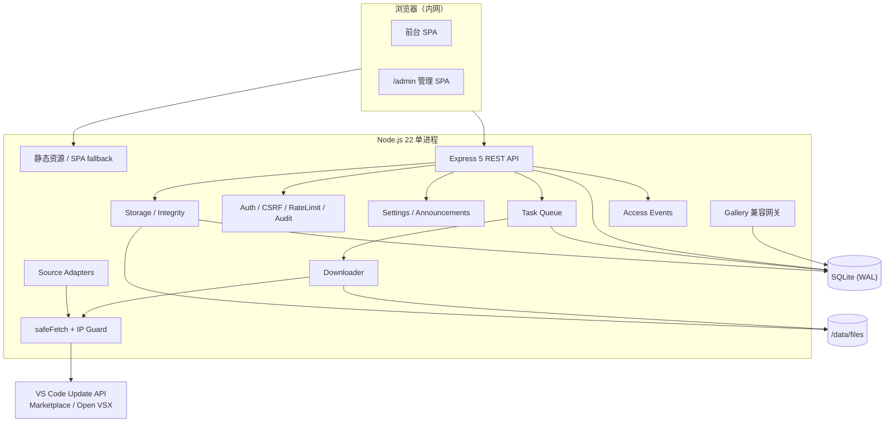

# 架构设计

本文档描述系统的模块边界、数据流、数据库模型与安全设计，供二次开发与运维参考。

## 1. 目标与约束

**目标**

- 完全隔离内网可用：浏览、下载、校验不依赖外网。
- 管理员仅在采集时需要访问上游数据源。
- 单进程、单容器、SQLite + 本地卷，降低部署与运维成本。
- 数据源、存储、前端可独立扩展。

**非目标**

- 多租户 / 多管理员 RBAC。
- 对象存储 / 分布式任务队列。
- 插件签名链验证。
- 替代官方 Marketplace 的完整生态功能。

## 2. 组件



## 3. 数据流

### 3.1 VS Code 安装包缓存

1. 管理员在后台选择版本与平台。
2. `POST /api/admin/vscode/cache` 按「版本 × 平台」创建 `tasks` 记录（`kind='vscode_package'`，`target_key` 唯一）。
3. Worker 取任务 → 请求 `https://update.code.visualstudio.com/{version}/{platform}/stable`（302）。
4. 从重定向地址提取 commit、文件名与构建时间戳；HEAD/Range 探测大小。
5. 流式下载到 `.part`，增量 SHA256，失败按 Range 续传。
6. 原子 rename → 写入 `vscode_packages` → 任务 `success`。
7. 前台按版本聚合展示；下载路由按 id 查库、限根目录发送。

### 3.2 按 commit 反查

1. 先查 `vscode_packages` / `remote_servers` 的 `commit_hash LIKE 'prefix%'`。
2. 未命中时拉取官方版本列表，对最近 150 个版本的 `linux-x64` 产物做 HEAD 探测并比对 commit 前缀（并发 8）。
3. 结果缓存 10 分钟；命中后 UI 自动将版本加入缓存选择。

> 官方 `api/update/{platform}/stable/{commit}` 只返回最新版本，不能可靠反查历史 commit，因此使用探测策略。

### 3.3 插件上传

1. `multer` 将文件写入 `tmp/uploads`，限制大小与扩展名。
2. 校验 zip 魔数；流式读取 `extension/package.json` 与 `extension.vsixmanifest`（条目数/解压大小上限）。
3. 合并元数据，提取图标（PNG/JPEG/GIF/WebP，按内容哈希命名）。
4. 计算 SHA256 → 移动到 `extensions/<publisher>/<name>/<version>/`。
5. 写入 `extensions` + `extension_categories`，记录审计。

### 3.4 市场缓存

1. 后台市场检索调用 `MarketplaceAdapter.search`（官方 `extensionquery` 或 Open VSX `/api/-/search`）。
2. 点击缓存时解析目标版本/平台，得到真实 vsix URL 与可选 SHA256。
3. 任务下载；官方 `vspackage` 常带 `Content-Encoding: gzip`，下载器按字节魔数判断是否解压（避免 undici 自动解压后二次 gunzip）。
4. 解析 vsix 元数据并入库，`source='marketplace:official'|'marketplace:openvsx'`。

### 3.5 Remote-SSH Server

1. 由 VS Code 版本解析 commit（同 3.1）。
2. 请求 `https://update.code.visualstudio.com/commit:{commit}/server-{platform}/stable`。
3. 下载并记录 `remote_servers(version, platform, commit_hash)`。

### 3.6 下载

- 路由：`GET /api/download/:type/:id`；`type` 仅允许白名单。
- 依据 DB 中的相对路径 + `resolveWithin` 限制在存储根目录。
- `sendFile` 提供 Range / ETag / Last-Modified；`Content-Disposition` 使用 RFC 5987。
- 单 IP 并发下载计数，超限 429 + `Retry-After`。
- 完成时写 `access_events(type='download')`；仅起始字节为 0 时递增 `download_count`。

### 3.7 访问日志

- 前端 `tracker.ts` 批量上报页面浏览、点击、搜索（≤20 条/批，5 秒或页面隐藏时 flush）。
- 服务端补充 IP、UA、Referer、匿名访客 ID；30 秒内同访客同路径浏览去重。
- 下载事件由服务端权威记录。
- 每日 03:00 清理超期事件；可整体关闭。

### 3.8 VS Code Gallery 兼容网关

`/api/gallery` 实现 VS Code 所需的只读子集：

| 路由 | 用途 |
| --- | --- |
| `POST /extensionquery` | 搜索已缓存插件，返回 marketplace 格式的 extensions/versions/files |
| `GET /publishers/:publisher` | 发布者信息 |
| `GET /publishers/.../vspackage` | 下载缓存的 vsix |
| `GET /asset/.../package.json` | 合成 package.json |
| `GET /asset/.../icon` | 重定向到图标静态文件 |
| `GET /item` | 重定向到前台插件页 |

- 扩展 ID 使用 `publisher.name`；gallery 的 `extensionId` 使用稳定哈希 UUID。
- `VSIXPackage` 文件指向 gallery 下载路由（不受前台访问码影响）。
- 客户端需在 `product.json` 配置 `extensionsGallery`，详见内置文档。

## 4. 模块划分

| 模块 | 职责 |
| --- | --- |
| `config.ts` | 环境变量解析、路径与限制默认值 |
| `db/` | SQLite 连接、WAL、迁移（`schema_migrations`） |
| `auth/` | scrypt、DB 会话、CSRF、限流 |
| `net/safeFetch.ts` | 出网安全层：协议/凭据/端口/DNS/IP/重定向/超时 |
| `net/ipGuard.ts` | IPv4/IPv6 公网判定、允许列表匹配 |
| `adapters/` | VS Code、官方市场、Open VSX、Remote-SSH、平台目录 |
| `services/downloader.ts` | 流式下载、续传、gzip 处理、SHA256、磁盘检查 |
| `services/queue.ts` | 任务认领、并发、重试、事件、取消、启动恢复 |
| `services/vsix.ts` | vsix 条目读取与元数据解析、图标提取 |
| `services/commitLookup.ts` | commit 反查与缓存 |
| `services/settings.ts` | 设置默认值、读写、公共配置 |
| `storage/` | 路径约束、资源 CRUD、用量、完整性校验 |
| `analytics/` | 访客 Cookie、事件写入、统计查询、清理 |
| `routes/gallery.ts` | VS Code gallery 兼容层 |
| `routes/admin/` | 管理端各模块 |
| `web/` | React SPA、埋点、文档 |

## 5. 数据库模型

| 表 | 用途 | 关键约束 |
| --- | --- | --- |
| `admin_users` | 管理员 | `username` 唯一 |
| `sessions` | 会话 | 仅存 token SHA256；级联删除 |
| `settings` | 键值配置 | `key` 主键 |
| `vscode_packages` | 安装包 | `UNIQUE(channel, version, platform)` |
| `extensions` | 插件版本 | `UNIQUE(extension_id, version, target_platform)` |
| `extension_categories` | 分类索引 | 复合主键；级联删除 |
| `remote_servers` | server 包 | `UNIQUE(version, platform)` |
| `tasks` | 任务 | `UNIQUE(kind, target_key)`；状态机约束 |
| `task_events` | 任务日志 | 级联删除 |
| `audit_logs` | 审计 | 管理端写操作 |
| `access_events` | 访问事件 | 类型约束；多索引 |
| `announcements` | 公告 | `published` + 时间窗 |
| `schema_migrations` | 迁移记录 | 版本号主键 |

所有查询使用预编译语句与参数绑定；动态 SQL 仅由固定片段组成。

## 6. 任务状态机

```text
queued ──claim──> running ──success──> success
                      │
                      ├──retryable & attempts < max──> running（内部退避）
                      ├──fatal──> failed ──retry──> queued
                      └──cancel──> canceled ──retry──> queued
```

- 服务启动时把 `running` 任务恢复为 `queued`。
- 重试复用 `.part`，先重算已下载部分的 SHA256 再 Range 续传；服务端不支持 206 时从头下载。
- 客户端断开或进程退出不会丢失任务状态；`.part` 超过 24 小时由维护任务清理。

## 7. 安全模型

- **认证**：scrypt（N=16384, r=8, p=1），`timingSafeEqual`；会话 token 32 字节，仅存 SHA256；12 小时绝对过期。
- **CSRF**：写请求校验 `Origin`/`Referer` 同源；无浏览器头时要求 `X-Requested-With: XMLHttpRequest`。
- **SSRF**：`safeFetch` 仅允许 http/https、拒绝 URL 凭据；公网仅 80/443；DNS 全量解析并拒绝私网/环回/保留地址；逐跳重定向复检；undici 自定义 `lookup` 在连接时绑定校验后的 IP。
- **上传**：大小/扩展名/zip 魔数/必需条目/条目数/解压上限；不解压整包；随机临时文件；原子移动；可选 ClamAV。
- **用户上传区**：公共区/私人共享统一限额（单文件大小、扩展名黑名单、双区总配额）+ `uploadLimiter` 频率限制；到期清理由 `services/expiry.ts` 每 30 分钟执行并写审计。
- **取件码**：scrypt 哈希存储 + 确定性 HMAC（服务端密钥）用于唯一索引查找；兑换 20 次/15 分钟/IP 限流；下载链接为 15 分钟 HMAC 令牌。
- **下载**：数据库主键路由 + 存储根目录约束 + `nosniff`；不暴露物理路径。
- **审计**：所有管理端写操作、登录成功/失败、访问码验证、任务重试/取消等。
- **响应头**：Helmet、CSP（`style-src 'unsafe-inline'` 供 Ant Design）、`frame-ancestors 'none'`。

## 8. 存储布局

```text
/data/registry.db
/data/files/
├── vscode/<channel>/<version>/<platform>/<filename>
├── extensions/<publisher>/<name>/<version>[@<platform>]/<filename>.vsix
├── remote-server/<version>/<commit>/<platform>/<filename>
├── software/<分类>/<软件名>/<版本|通用>/<filename>      # 任意软件安装包，同名 .md 为说明
├── public/<timestamp>-<safe-filename>                  # 公共区文件（到期自动删除）
├── shares/<timestamp>-<safe-filename>                  # 私人取件文件（到期自动删除）
├── icons/<sha256-prefix>.<png|jpg|gif|webp>
└── tmp/uploads/<random>
```

## 9. 扩展点

- **新增数据源**：实现 `MarketplaceAdapter` 或仿照 `resolveVSCodePackage`，注册到 `adapters/index.ts`；所有出网必须走 `safeFetch`。
- **新增资源类型**：扩展 `artifacts.ts` 的类型映射、下载路由白名单、前端页面与存储统计（`software` 即按此路径接入）。
- **新增用户上传区**：仿照 `services/fileZone.ts` 的「限额校验 → 落盘 → 到期清理」管线，公开路由挂 `requireUserAccess` + `uploadLimiter` + `originGuard`。
- **替换存储后端**：抽象 `storage/` 的路径与读写，保持元数据中的 `stored_path` 为相对标识。
- **接入 SSO**：可在反向代理层完成认证，并把用户标识写入受信任头；当前系统仍以共享访问码/单管理员为边界。

## 10. 已知权衡

- 单进程 Worker + SQLite：简单可靠，但不适合多副本水平扩展。
- 访问事件直接写入 SQLite：便于查询，但高流量场景需引入批量写/外部分析库。
- 插件搜索使用 `LIKE`：数千级规模足够；更大规模建议引入 FTS5。
- Gallery 网关只覆盖 VS Code 所需子集，未实现评分、评论、推荐与遥测。
